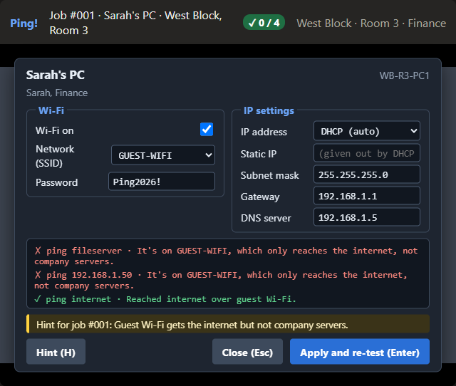
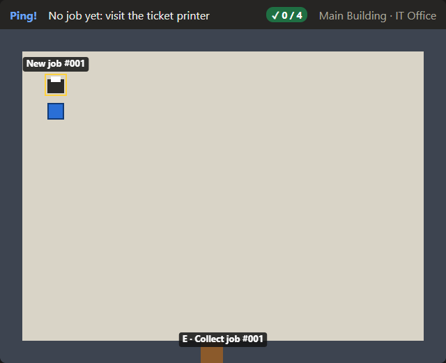
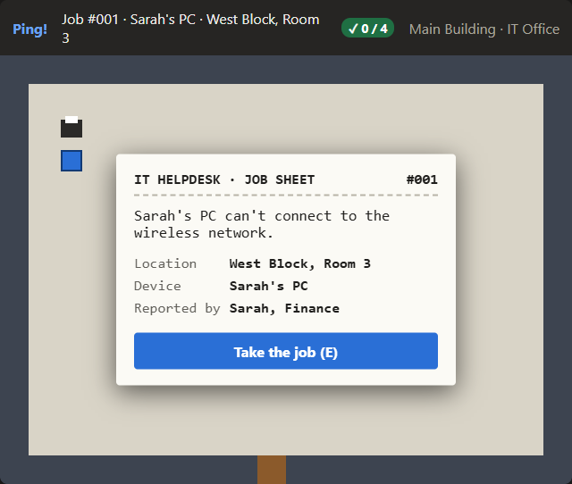
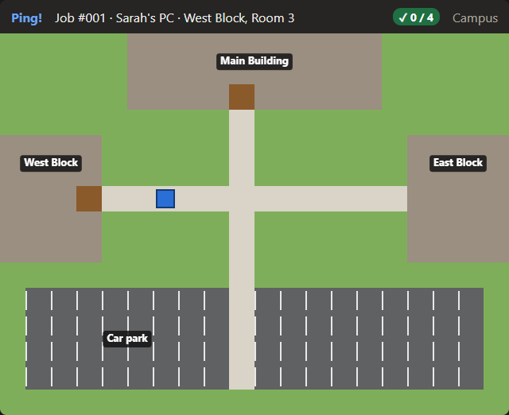
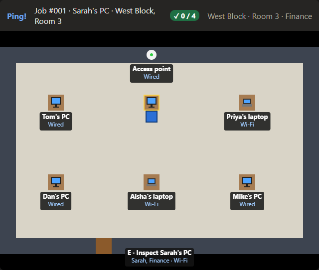
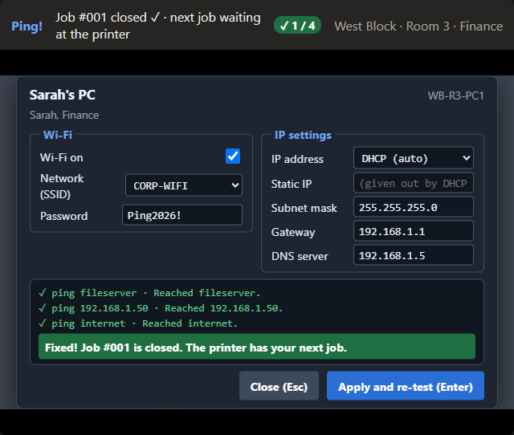

# Ping!

A top-down browser game where you play the new IT technician on a small office campus. Collect a job from the ticket printer, walk to the broken device, work out what's wrong with its network settings, and fix it.

**Play it here: https://joshspritchard.github.io/ping-game/**



## How to play

1. You start in the **IT Office**. Walk up to the **ticket printer** (top left) and press **E** to collect a job.
2. The **job sheet** tells you what's wrong, where, and which device. The job stays in the bar at the top while you walk.
3. Walk out of the office, across the **campus** and into the right building and room. Doors take you between maps, and every door has a sign.
4. Stand next to the device and press **E** to open its **config screen**. The pings at the bottom show what it can and can't reach: that's your clue.
5. Change the setting you think is wrong and press **Apply and re-test**. If the pings go green, the job is fixed and the printer has your next one.

Stuck? Press **H** on the config screen for a hint. Comparing with a device that works also helps.

There are **4 jobs**. Can you fix them all?

## Controls

| Key | What it does |
|---|---|
| **W A S D** or **arrow keys** | Walk |
| **Shift** (hold) | Sprint |
| **E** | Collect a job at the printer, or inspect a device |
| **H** | Show a hint (on the config screen) |
| **Enter** | Apply and re-test (on the config screen) |
| **Esc** | Close the job sheet or config screen |

## Screenshots

| | |
|---|---|
|  |  |
| **The IT Office:** a new job is waiting at the printer. | **The job sheet:** what's wrong, where, and which device. |
|  |  |
| **The campus:** three buildings and a car park. | **West Block, Room 3:** every device shows its owner and how it connects. |
|  |  |
| **The config screen:** the pings show what's broken. | **Fixed!** The job closes and the counter goes up. |

## The network rules

Every fault in the game is one of these. When you press Apply and re-test, `testConnection` in [`js/network.js`](js/network.js) checks them in this order and stops at the first one that fails:

1. **Is it connected?** Wired: is the cable plugged into a working switch port? Wi-Fi: is Wi-Fi on, is there a working access point in the room, and are the network name (SSID) and password right?
2. **Which network?** `CORP-WIFI` and wired ports are the company network. `GUEST-WIFI` only reaches the internet.
3. **Does it have a valid IP?** DHCP hands one out automatically. A static IP must be on the company network (192.168.1.x) and not used by another device.
4. **Can it reach the target?** If it's on the same network (worked out with the subnet mask), it goes there directly. If not, it needs the right **default gateway** (the router).
5. **By name?** Turning a name like `fileserver` into an IP address needs the right **DNS** server.

## How it's built

Plain HTML, CSS and JavaScript, with a `<canvas>` for the world: no frameworks and no build step. The world is a grid of 32-pixel tiles. The network rules are kept separate from the drawing code, so they can be tested on their own.

```
ping-game/
├── index.html        canvas, job bar, job sheet and config screen
├── style.css
├── js/
│   ├── main.js       game loop: update, draw, switch maps
│   ├── input.js      keyboard (WASD, arrows, Shift, E, H, Esc)
│   ├── world.js      loading maps and drawing tiles, devices and labels
│   ├── player.js     movement, wall collisions, "what am I next to?"
│   ├── inspect.js    the config screen and its pings
│   ├── tickets.js    ticket printer, job sheet, faults, closing jobs
│   └── network.js    the rules: testConnection(device, target, devices)
├── data/
│   ├── maps.json     campus, buildings and rooms, as grids of characters
│   ├── devices.json  every device and its working settings
│   └── tickets.json  the jobs: which device, what's broken, what fixes it
└── docs/
    ├── Ping-Starter-Sheet.html   the original brief for the week
    └── screenshots/
```

A job is just data: it names a device, breaks one setting (`fault`) and says what has to work again (`fixedWhen`). Adding a new job means adding a few lines to `tickets.json`, with no new code.

### Try the rules yourself

Open the game, press **F12** to open the browser console, and paste:

```js
const sarah = devices.find(d => d.id === "WB-R3-PC1");
testConnection(sarah, "fileserver", devices)     // ok: reached the fileserver
sarah.dns = "";
testConnection(sarah, "fileserver", devices)     // fails: no DNS server, so it can't look up the name
testConnection(sarah, "192.168.1.50", devices)   // ok: by IP still works
```

## Running it on your own computer

The game loads its maps, devices and jobs with `fetch`, which doesn't work if you just double-click `index.html`. Serve the folder with a small web server instead. From the `ping-game` folder, run:

```bash
python -m http.server 5500
```

then open http://localhost:5500. (The VS Code **Live Server** extension works too.)

## How I made it

I built Ping! during a week of work experience, starting from an empty repository and the [starter sheet](docs/Ping-Starter-Sheet.html). Each feature was a GitHub Issue, built on its own branch and merged through a pull request. I used **Claude** to help write, explain and debug the code, **GitHub** to store it, track Issues and publish the game with GitHub Pages, and tested every change in the browser before merging.

## What I learned

<!-- Josh: write this part in your own words. Some questions to get you started:
     - What did you know about networks before this week, and what do you know now?
     - Which part of the code do you understand best? (Collisions? testConnection? The game loop?)
     - What was the hardest bug, and how did you find it?
     - What surprised you about using Git, pull requests or Claude? -->

_Coming soon._

## What I'd build next

<!-- Josh: one thing you'd add with another week (more buildings? a timer? new kinds of fault?). -->

_Coming soon._
